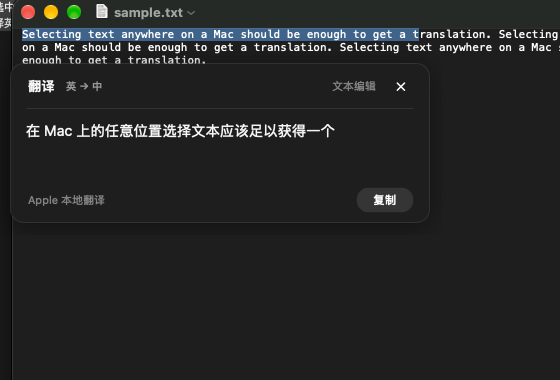
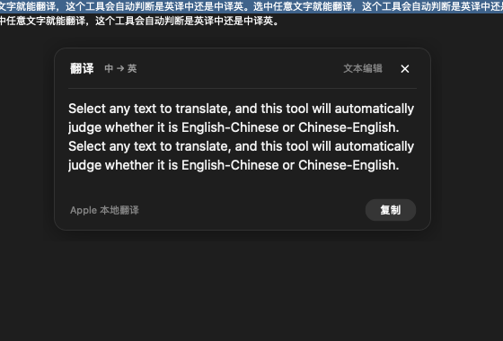

# 划词翻译（SelectTranslate）

[](https://github.com/xm-tech/select-translate/actions/workflows/build.yml)
[](https://github.com/xm-tech/select-translate/releases)
[](LICENSE)

macOS 菜单栏小工具：**在任何 App 里选中文字 → 选区下方浮出「译」按钮 → 点击 → 弹出翻译卡片**。
点卡片右上角 ✕、按 Esc、或点任何其他地方都会收起卡片。

- 中英**双向**：默认自动判断方向（中文→英文、英文→中文），也可以在菜单里锁定「英译中」或「中译英」
- 不依赖浏览器插件，Terminal、TextEdit、Chrome、VS Code、PDF、微信……只要能选中文字都行
- 链路：Apple 本地（若语言包已装）→ 腾讯翻译 → MyMemory → Google（前一个失败自动降级）
- Apple 本地翻译：macOS 26+ 内置 Translation 框架，离线、免费、无需账号；首次要在
  菜单栏「翻译服务 → 下载 Apple 本地语言包…」里下载语言包（英→中、中→英各一份）
- 原生 AppKit 实现，无 Dock 图标，常驻菜单栏

<p>
  
  
</p>

> 上图：选中英文自动译成中文；下图：选中中文自动译成英文。卡片标题旁的「英 → 中 / 中 → 英」是方向徽标。

## 环境要求

- macOS 13 及以上（Apple 本地翻译需要 macOS 26 及以上）
- 无需 Xcode，只要 Command Line Tools（`xcode-select --install`）；本仓库的构建脚本直接调用 `swiftc`
- 首次运行需要在「系统设置 → 隐私与安全性 → 辅助功能」里授权

---

## 安装

### 方式一：下载现成的 App（推荐给普通用户）

去 [Releases](https://github.com/xm-tech/select-translate/releases) 下载最新的 `SelectTranslate-vX.Y.zip`，
解压后把 `SelectTranslate.app` 拖进「应用程序」（或 `~/Applications`）。

这个 App 是 **ad-hoc 签名**（没有 Apple 开发者证书），所以第一次打开可能提示「无法验证开发者」：

- 在 Finder 里 **右键 → 打开**，再确认一次；或
- 终端执行 `xattr -dr com.apple.quarantine SelectTranslate.app` 后双击

打开后照旧要在「系统设置 → 隐私与安全性 → 辅助功能」里勾选它。

### 方式二：从源码构建

```bash
cd select-translate        # 仓库根目录
./scripts/install.sh          # 构建 + 安装到 ~/Applications + 启动
```

手动方式：把 `dist/SelectTranslate.app` 拖到 `/Applications`（或 `~/Applications`）后双击打开。

### 首次运行必须授权「辅助功能」

没有这个权限，App 读不到其它 App 里选中的文字：

1. 首次启动会弹出「开启「辅助功能」权限」窗口，点 **打开系统设置**
2. 系统设置 → 隐私与安全性 → 辅助功能 → 勾选 **划词翻译**
3. 回到 App，状态会变成「已授权 ✓」（菜单栏里也能看到）

> 权限按「路径 + 签名」记录。用 `install.sh` 重新构建（ad-hoc 签名会变）后，系统可能要求重新勾选一次。

### 划词不出按钮？（更新后最常见）

现象：菜单栏图标在，但选中文字不弹「译」，日志 `~/Library/Logs/SelectTranslate.log` 里是 `launched trusted=false`。

原因：ad-hoc 签名每次构建 cdhash 都会变，系统设置里那一行**看起来还是开启的，其实已经失效**——单纯关掉再打开开关也没用。

一条命令修好：

```bash
./scripts/regrant.sh
```

它会：移除系统设置里的旧条目 → 重启 App 让它重新申请 → 自动打开开关 → 校验日志出现 `launched trusted=true`。

手动版：系统设置 → 隐私与安全性 → 设备控制与数据访问 → 选中「划词翻译」→ 点列表下方的 **−** 删除 → 重启 App → 再打开开关。

---

## 使用

| 步骤 | 说明 |
| --- | --- |
| 1 | 在任意 App 里用鼠标拖选一段英文或中文（双击选中单词也行） |
| 2 | 选区下方浮出深色「译」按钮 |
| 3 | 点击按钮 → 立刻弹出卡片，先显示「正在翻译…」，随后显示译文（标题旁有「英 → 中」/「中 → 英」徽标） |
| 4 | 卡片里可以 **复制** 译文、点 ✕ 关闭；点别处 / Esc 也会关闭 |
| 5 | 翻译失败会显示原因和 **重试** 按钮 |

菜单栏图标（`character.bubble`）里的功能：

- **翻译当前选中的内容**（读取选区后直接在浮窗里翻译，不用先点按钮）
- **启用划词按钮**（开关）
- **读不到文字时模拟 ⌘C**（剪贴板兜底开关）
- **翻译方向**：自动检测（推荐）/ 英译中 / 中译英
- **翻译服务**：自动 / Apple 本地翻译 / 腾讯翻译 / MyMemory / Google
- **下载 Apple 本地语言包…**：打开语言包状态窗口，两个方向各自显示是否已下载，缺哪个点一下由系统下载
- **辅助功能权限**：已授权状态、打开系统设置
- **运行诊断…**：检查权限、当前前台 App、能否读到选区、各翻译服务的连通性（含 Apple 两个方向）
- **测试翻译…**：手动输入任意文字试用
- **打开日志**、**关于**、**退出**

---

## 两类 App 的差异（重要）

| App 类型 | 例子 | 定位方式 |
| --- | --- | --- |
| 原生 App（走辅助功能 API） | TextEdit、Finder、Safari、备忘录、PDF | 精确读取选区文字与坐标，按钮就在选区正下方 |
| 浏览器 / Electron / 终端 | Chrome、VS Code、Slack 等 | 这些 App 不通过辅助功能暴露选区，改用「拖选后模拟一次 ⌘C」探测：按钮出现在**鼠标松开的位置**下方 |

关于 ⌘C 兜底：

- 只有**拖选**（移动超过 4pt）或**双击/三击**之后才会探测，普通单击不会触发
- 探测时先备份剪贴板内容，复制到文字后**立刻还原**，不会污染你的剪贴板
- 只在剪贴板真的发生变化（说明确实有选中内容）时才弹按钮，所以不会误弹
- 1Password、钥匙串、Bitwarden 等密码类 App 里**永不**探测
- 局限：在无辅助功能选区的 App 里，用键盘（Shift+方向键）选中文字不会触发按钮——原生 App 没这个问题

---

## 开发

```bash
./scripts/build.sh          # swiftc 编译 + 生成图标 + 打包 + ad-hoc 签名
./scripts/install.sh        # build.sh + 安装到 ~/Applications + 启动

# 本机是纯 Command Line Tools 环境，且沙箱禁止写 /var/folders 下的默认模块缓存，
# 所以 `swift build` 会失败；scripts/build.sh 直接调用 swiftc 并指定
# -module-cache-path .tmp/modcache，这是唯一受支持的构建路径。

# 构建脚本会检查 SDK 版本：低于 macOS 26 时自动跳过 Apple 本地翻译模块
# （-DNO_APPLE_TRANSLATION），其余功能照常构建，适合只有 Xcode 15/16 的机器。

# 命令行自测
dist/SelectTranslate.app/Contents/MacOS/SelectTranslate --selftest   # 三个翻译服务 + 长文分块
dist/SelectTranslate.app/Contents/MacOS/SelectTranslate --axtest     # 打印当前选区读取结果
dist/SelectTranslate.app/Contents/MacOS/SelectTranslate --snapshot /tmp/snap   # 渲染卡片截图
```

源码结构与端到端测试：

```
Sources/SelectTranslate/
  main.swift            入口与命令行模式（--selftest/--axtest/--icon/--snapshot/--log）
  AppDelegate.swift     菜单栏、诊断、测试翻译、引导授权
  OverlayController.swift  0.7s 轮询选区、浮层定位、事件监听（点别处/Esc 关闭）
  OverlayViews.swift    胶囊按钮 PillView、结果卡片 ResultCardView（自绘深色卡片）
  SelectionService.swift   辅助功能（AX）读选区 + ⌘C 剪贴板兜底
  Translator.swift      腾讯 / MyMemory / Google 三个 provider、分块、缓存
  OnboardingWindow.swift   授权引导窗口
  Settings.swift / Log.swift

Tools/                   端到端验证用的独立小程序（不属于 App）
  e2e.swift              TextEdit：精确选区 → 按钮位置 → 点译 → ✕ / 复制 / 点别处关闭
  e2e-chrome.swift       Chrome：拖选 → ⌘C 兜底 → 按钮 → 翻译 → 关闭
  e2e-vscode.swift       VS Code：同上（Electron 场景）
  axtree.swift           打印任意 App 的辅助功能树摘要（排查选区读不到的问题）
  chrometest.swift       在 Chrome 里合成 ⌘A 后读选区，验证 AX 能力
```

三套端到端用例已验证通过（TextEdit / Chrome / VS Code），断言覆盖：按钮出现在选区下方、结果卡片出现、译文写入日志、✕ 关闭、复制到剪贴板、点别处关闭。

---

## 隐私

- 只在你**拖选 / 双击选中文字之后**才读取文字，不常驻监听输入
- 选区文字只发给当前选择的翻译服务（腾讯 / MyMemory / Google），不落盘、不上传别处
- 剪贴板兜底读取后会原样还原剪贴板；日志只记录字符数，不记录内容
- 最多翻译 5000 字符，超出截断

---

## 许可

MIT，见 [LICENSE](LICENSE)。
